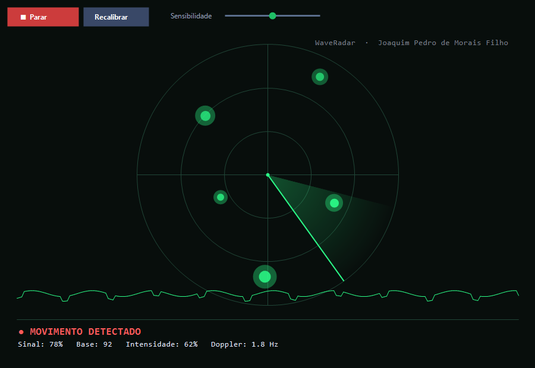

<div align="center">

# 📡 WaveRadar for Windows

### Native Wi-Fi motion radar for Windows — no extra hardware

A self-contained Windows app (C#/WinForms) that reads your Wi-Fi signal strength
and turns the perturbations caused by moving people into a **live radar display** —
sweep, blips, motion intensity and a Doppler estimate.

**By Joaquim Pedro de Morais Filho · j360074@hotmail.com**



</div>

---

## What it is

This is the **native Windows build** of [WaveRadar](../README.md) — a single
lightweight `.exe` (no Python, no browser, no drivers). It uses the **RSSI mode**:
it samples the signal strength of your current Wi-Fi link
(`netsh wlan show interfaces`), learns the quiet channel during an 8-second
calibration, and then shows motion in the room as blips on a radar, with an
estimated Doppler frequency in the 0–6 Hz band that matches human movement.

- 🪟 **Native Windows** — one `.exe`, ~16 KB, no dependencies
- 📶 **No extra hardware** — any router + your PC's Wi-Fi
- 🎛️ Sensitivity control, recalibration, live signal history
- 🔒 **Private** — reads only your own link's signal metric; nothing leaves the PC

> For the richer **CSI / ESP32** mode (per-subcarrier amplitude + phase), see the
> main project and the [`firmware/esp32/`](../firmware/esp32/) folder.

## Run

- **Easiest:** download `WaveRadar.exe` from the
  [**windows-v1.0.0 release**](https://github.com/elevbit-ai/waveradar/releases/tag/windows-v1.0.0)
  and double-click it.
- Click **Iniciar**, stay still during the 8-second calibration, then walk across
  the room between your PC and the router — you'll see the blips.

## Build from source

Requirements: Windows with the **.NET Framework** (ships with Windows) — nothing to install.

```powershell
# compile (uses the built-in C# compiler)
& "$env:WINDIR\Microsoft.NET\Framework64\v4.0.30319\csc.exe" `
    /target:winexe /out:WaveRadar.exe `
    /r:System.Windows.Forms.dll /r:System.Drawing.dll /r:System.dll WaveRadar.cs
```

Or run the helper: **`build.ps1`** (compiles and, if the Windows SDK is present,
packages the MSIX in `msix/`).

## Microsoft Store

WaveRadar for Windows is packaged as **MSIX** (see [`msix/`](msix/)) and published
on the Microsoft Store. The `AppxManifest.xml` uses `runFullTrust` only to run the
native `.exe` and call `netsh` for the Wi-Fi metric.

## How the sensing works (short version)

```
router ))) Wi-Fi ))) moving body perturbs the link ))) RSSI wobbles ))) radar blip
```

A person moving in the room changes the multipath between your router and PC. That
shows up as fluctuations in the reported signal strength. WaveRadar compares the
live signal against a quiet baseline (mean ± noise), scales the deviation by your
sensitivity setting into a motion **intensity**, and estimates a **Doppler**
frequency from the zero-crossing rate of the signal's oscillation. Android does not
expose richer data to apps, and Windows RSSI updates are slower than true CSI, so
this mode reports **presence, intensity and a rough Doppler** — not precise bearing.

## Author & license

**Joaquim Pedro de Morais Filho** · j360074@hotmail.com — [MIT](../LICENSE)
